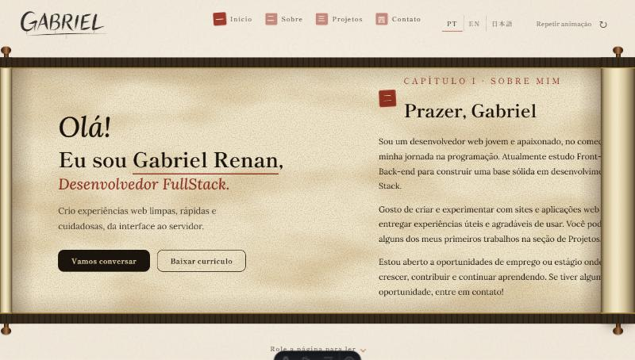
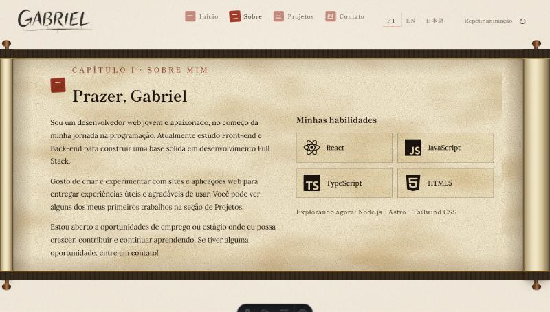
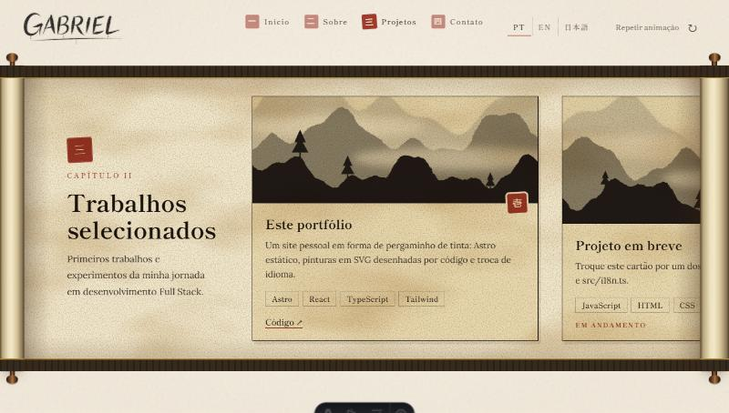
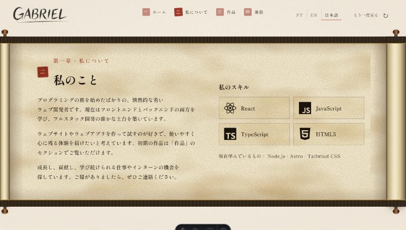

<div align="center">

# 🖌️ Portfólio · Gabriel Renan

**Um portfólio em forma de pergaminho japonês (_emakimono_):**
o nome é escrito a pincel, o rolo se abre e a história corre para o lado conforme você rola a página.


<br />



</div>

---

## ✨ Destaques

- **Nome escrito a pincel, ao vivo.** Cada pincelada é um caminho SVG desenhado aos poucos, com bordas irregulares de tinta e gotas que escorrem.
- **Pergaminho que se abre.** Ao carregar, dois rolos de madeira se afastam e o papel se desenrola entre eles. Os rolos engrossam e afinam conforme você lê.
- **Rolagem para o lado.** Rolar a página para baixo move o papel horizontalmente, na mesma velocidade, sem sequestrar a rolagem.
- **Texto escrito no papel.** A tinta se mistura com a textura (fibras e manchas geradas pelo navegador), em vez de aparecer com animação.
- **Espaço para pinturas de nanquim.** Cinco regiões recebem pinturas que se fundem ao papel, com bordas que esmaecem e um véu suave para manter o texto legível.
- **Três idiomas:** português (padrão), inglês e japonês, com troca instantânea e lembrança da escolha.
- **Leve e acessível.** Páginas estáticas, nenhuma imagem pesada obrigatória, foco visível para teclado e respeito a `prefers-reduced-motion`.

<div align="center">

| Sobre mim | Projetos |
| :---: | :---: |
|  |  |



<sub>As telas acima não incluem a pintura de fundo, que ainda é provisória.</sub>

</div>

---

## 🧰 Tecnologias

| Camada | O que usa | Para quê |
| --- | --- | --- |
| Framework | **Astro** | Gera HTML estático e envia só o JavaScript necessário |
| Linguagem | **TypeScript** | Lógica da rolagem, dos idiomas e das animações |
| Estilo | **CSS moderno** | Variáveis, `clamp()`, `mix-blend-mode`, `mask-image`, `clip-path`, `position: sticky` |
| Desenho | **SVG** | Escrita do nome, paisagens procedurais e texturas (`feTurbulence`) |
| Animação | **Web Animations API** e `requestAnimationFrame` | Abertura do rolo, escrita a pincel e gotas |
| Fontes | **Shippori Mincho** e **Lora** (via Fontsource) | Títulos com ar de caligrafia e texto corrido legível |
| Ícones | **react-icons** | Logos das tecnologias (renderizados estaticamente) |

> Não há biblioteca de animação: os efeitos usam recursos nativos do navegador.

---

## 🚀 Como rodar

Requisitos: **Node.js 22.12 ou superior**.

```bash
# instalar as dependências
npm install

# servidor de desenvolvimento (http://localhost:4321)
npm run dev

# build de produção, gerado em dist/
npm run build

# visualizar o build localmente
npm run preview
```

Para ver onde cada pintura entra no pergaminho, abra `http://localhost:4321/?slots`.

---

## 🗂️ Estrutura

```text
.
├── docs/
│   ├── art-prompts.md        # prompts e regras para gerar as pinturas
│   ├── ink-intro.md          # como funciona a abertura e o rolo
│   └── screenshots/          # imagens usadas neste README
├── public/
│   └── art/                  # coloque aqui as pinturas (webp/jpg)
└── src/
    ├── art.ts                # quais pinturas existem e onde entram
    ├── data.ts               # links, tecnologias e projetos
    ├── i18n.ts               # todos os textos em PT, EN e JA
    ├── components/
    │   ├── Emakimono.astro   # o pergaminho: papel, rolos, painéis e rolagem
    │   ├── InkSignature.astro# o nome escrito a pincel (SVG + animação)
    │   ├── InkLandscape.astro# paisagens de nanquim geradas por código
    │   ├── SiteHeader.astro  # assinatura no canto e ferramentas
    │   └── LangSwitch.astro  # seletor de idioma
    ├── lib/
    │   ├── ink-strokes.ts    # geometria e tempo de cada pincelada
    │   ├── ink-fluid.ts      # forma das gotas de tinta
    │   └── lang.ts           # troca de idioma no navegador
    ├── pages/index.astro     # a única página
    └── styles/global.css
```

> Alguns componentes em `src/components` (`Hero.tsx`, `About.tsx`, `Projects.tsx`, `Contact.tsx`, `Navbar.tsx`, `Footer.astro`, `Reveal.tsx`, `ScrollProgress.tsx`, `WaterBackground.tsx`, `WaveDivider.astro`) são restos da primeira versão, com tema azul. Eles **não são usados** e serão removidos.

---

## 🎨 Como personalizar

| Quero mudar... | Edite |
| --- | --- |
| Nome, links, telefone, currículo, projetos | `src/data.ts` |
| Qualquer texto ou tradução | `src/i18n.ts` |
| As pinturas do pergaminho | `src/art.ts` e `public/art/` |
| Velocidade da escrita do nome | `INK_SPEED` em `src/lib/ink-strokes.ts` |
| Cores e textura do papel | variáveis em `.emaki` e `.track`, em `Emakimono.astro` |

**Formulário de contato.** Sem configuração, o botão abre o seu app de e-mail. Para enviar direto, crie um formulário (por exemplo no Formspree) e coloque a URL em um arquivo `.env`, seguindo o `.env.example`:

```bash
PUBLIC_FORM_ENDPOINT=https://formspree.io/f/SEU_ID
```

**Adicionar uma pintura.** Salve o arquivo em `public/art/` e preencha o `src` dela em `src/art.ts`. Cada pintura aceita `position`, `fit` e `filter` (por exemplo, `brightness(1.1) contrast(1.2)` para empurrar um fundo amarelado para o branco). O guia completo, com prompts, está em [`docs/art-prompts.md`](docs/art-prompts.md).

---

## 🧠 Como funciona (resumo)

1. **Rolagem para o lado.** A página é muito alta, e o pergaminho fica "preso" na tela (`position: sticky`). Um script converte `scrollY` em `translateX`, então rolar para baixo move o papel.
2. **Escrita a pincel.** Cada traço é um caminho SVG usado como máscara; animar o `stroke-dashoffset` revela o desenho. As gotas são recalculadas a cada quadro.
3. **Papel e tinta.** A textura vem do filtro `feTurbulence`. Textos e pinturas usam `mix-blend-mode: multiply`, então o branco some e só a tinta aparece sobre o papel.
4. **Idiomas.** Os elementos têm `data-i18n`; o script troca o texto e guarda a escolha no `localStorage`. O servidor sempre entrega o português.

---

## 🗺️ Próximos passos

- [ ] Adicionar as cinco pinturas de nanquim ao pergaminho
- [ ] Substituir os projetos de exemplo pelos projetos reais
- [ ] Preencher os links do LinkedIn e do GitHub e o currículo em PDF
- [ ] Conectar o formulário de contato a um serviço de envio
- [ ] Remover os componentes não usados da primeira versão
- [ ] Publicar o site (Vercel, Netlify ou GitHub Pages)

---

## 📄 Créditos e licença

- Fontes: [Shippori Mincho](https://fonts.google.com/specimen/Shippori+Mincho) e [Lora](https://fonts.google.com/specimen/Lora), distribuídas pelo [Fontsource](https://fontsource.org) sob a licença SIL OFL.
- Todas as paisagens, o nome escrito a pincel e as texturas são gerados por código.
- Pinturas de terceiros só entram no projeto depois de confirmada a licença.
- © Gabriel Renan. Todos os direitos reservados.

<div align="center">

Feito com tinta, papel e um pouco de **Kaizen** · 改善

</div>
